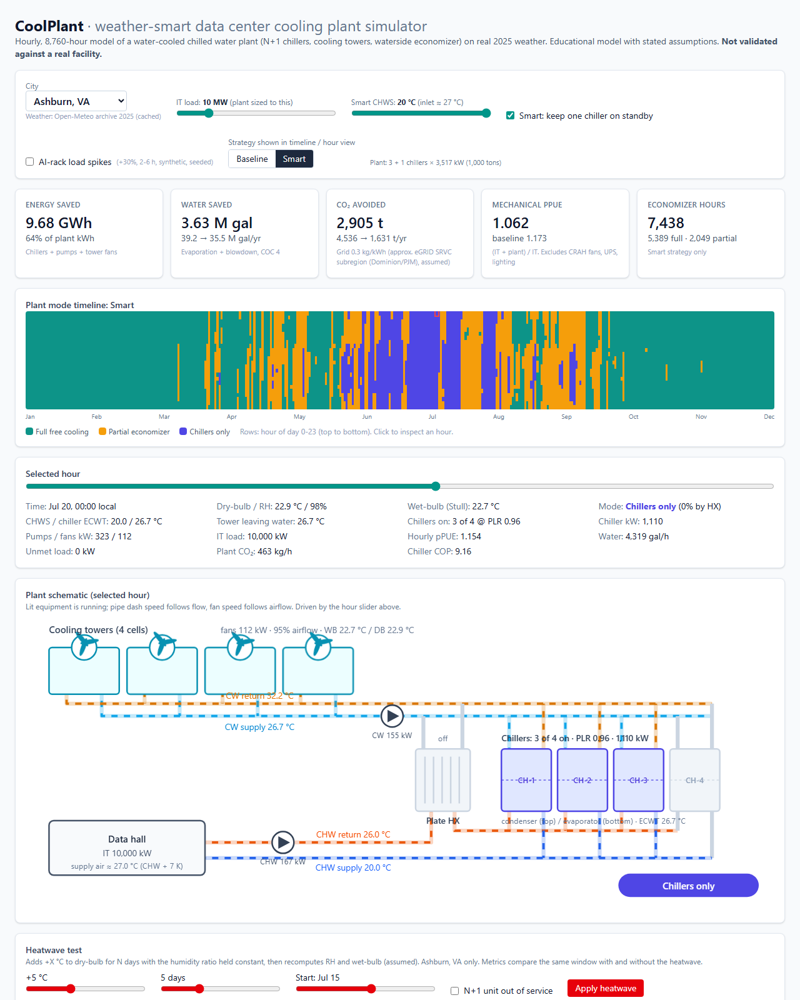

# CoolPlant: a weather-smart data center cooling plant simulator

CoolPlant runs an hourly, full-year (8,760 h) energy and water model of a water-cooled chilled water plant serving a data center: N+1 chillers, cooling towers, a waterside economizer (plate heat exchanger), and variable-speed pumps and fans. It runs the model on real hourly weather and compares two control strategies. **Baseline** uses a fixed 7 °C chilled water supply, no economizer, and load-only chiller staging. **Smart** runs an elevated chilled water supply setpoint (14–20 °C, adjustable; server inlet stays inside the ASHRAE TC 9.9 recommended limit), free-cools whenever the wet-bulb allows, and picks the chiller count that draws the least power. The app reports annual plant energy, makeup water, CO₂ and mechanical pPUE for both strategies, and the savings. Everything runs in the browser, every assumed number is shown in the UI, and the equations are below so each result can be checked by hand.

> **This is an educational model.** It uses textbook relationships and stated assumptions. It has **not** been validated against a real facility, and its absolute numbers should not be used for design.


<!-- TODO: replace with a screenshot or GIF of the running app -->

## Status

| Phase | Scope | State |
|---|---|---|
| 1 | One city (Ashburn, VA), plant model, baseline vs smart, charts, unit tests | Done |
| 2 | All five cities (Ashburn, Phoenix, Council Bluffs, Dublin, Singapore) + city comparison view | Done |
| 3 | Heatwave stress test + animated plant schematic | Done |

## How the model works

For each hour *h*, the model takes outdoor dry-bulb *T* and relative humidity *RH*, computes wet-bulb, then solves the plant for that hour's IT load. There is no thermal storage or dynamics: each hour is a steady state.

### 1. Weather and wet-bulb

Weather data is hourly `temperature_2m` and `relative_humidity_2m` for 2025 (8,760 hours, local time) from the [Open-Meteo historical archive API](https://open-meteo.com/en/docs/historical-weather-api), which is free and needs no key. A cached copy is committed in `src/data/weather/`, so the app works offline.

Wet-bulb uses Stull (2011):

```
Tw = T·atan(0.151977·√(RH + 8.313659)) + atan(T + RH) − atan(RH − 1.676331)
     + 0.00391838·RH^1.5·atan(0.023101·RH) − 4.686035
```

The formula is valid for RH 5–99 % and T −20 to 50 °C at sea-level pressure, with errors mostly within ±0.3 °C. RH is clamped to that range, and Tw is never allowed to exceed T.

### 2. Load and plant sizing

| Item | Equation / value |
|---|---|
| Cooling load | Q_cool = IT load + CHW pump power. All IT power and all CHW pump power end up as heat in the CHW loop. |
| AI-rack spikes (optional) | Seeded random bursts of 2–6 h at +30 % IT. A burst starts with probability 0.03 per hour. |
| Chiller unit size | 3,517 kW (1,000 tons) |
| Duty chillers | N = ceil((IT_design + P_chw,design) / 3,517 kW); installed = N + 1 |
| Design heat rejection | Q_rej,design = Q_cool,design · (1 + 1/COP_design) |

### 3. Chiller

Full-load COP is a Carnot fraction that falls smoothly at low lift. A loss-equivalent lift L0 stands in for the fixed losses (compressor, motor, heat-exchanger) that do not shrink when lift shrinks:

```
T_evap = CHWS − 2 K                      (evaporator approach)
T_cond = ECWT + 7 K                      (5.5 K condenser range + 1.5 K approach)
lift   = T_cond − T_evap
η_max  = η_design · (lift_design + L0) / lift_design      η_design = 0.68, L0 = 20 K
COP_full = min( η_max · T_evap[K] / (lift + L0), 14 )
```

lift_design is the lift at 7 °C CHWS and 29.4 °C (85 °F) ECWT (31.4 K). At that point the equation reduces to 0.68 × Carnot, which gives COP ≈ 6.0 (≈ 0.58 kW/ton). The effective Carnot fraction η_design · (lift / lift_design) · (lift_design + L0) / (lift + L0) falls as lift falls, so COP stays finite and keeps responding to condenser water temperature in every hour. Some reference points:

| CHWS | ECWT | COP | kW/ton |
|---|---|---|---|
| 20 °C | 28 °C | ≈ 8.8 | ≈ 0.40 |
| 20 °C | 15.5 °C (lowest lift reachable) | ≈ 13.2 | ≈ 0.27 |

The 14 ceiling (≈ 0.25 kW/ton) is only a safety bound. The app reports the hours where it binds, and with the defaults that is zero.

Part-load power uses a quadratic power-fraction curve:

```
P_chiller = n · (Cap / COP_full) · (a + b·PLR + c·PLR²)     a = 0.2229, b = 0.3134, c = 0.4637
PLR = max(load_on_chillers / (n · Cap), 0.15)
```

Because a + b + c = 1, the curve gives rated full-load power at PLR = 1, and the best kW/kW is near PLR ≈ 0.69. The curve's shape is typical of a VSD centrifugal chiller, but the coefficients are illustrative and are not taken from any manufacturer. Below PLR 0.15 the chiller is treated as false-loaded.

Capacity derates by 1.5 % per K of ECWT above 29.4 °C. Chiller ECWT has a head-pressure floor of 15.5 °C.

**Staging:**

- **Baseline:** run the fewest chillers that carry the load: n = ceil(load / Cap).
- **Smart:** try every n from that minimum up to an allowed maximum, and run the n with the lowest chiller kW. The **keep one chiller on standby** toggle (default on) sets that maximum to N, so the N+1 unit starts only when the load cannot be carried without it. With the toggle off, the maximum is N+1. Running all units near their best PLR saves a little energy but spends redundancy, and the model does not price that risk.

If load exceeds installed capacity, the shortfall is reported as unmet load.

### 4. Cooling tower

Tower leaving water depends on plant mode, and is never below a 10 °C freeze-protection floor:

| Mode | Tower leaving water |
|---|---|
| Chillers only | max(WB + 4 K, 15.5 °C condenser-water floor, 10 °C) |
| Partial economizer | max(WB + 4 K, 10 °C), as cold as the tower can make it |
| Full free cooling | max(CHWS − 1.5 K HX approach, 10 °C) |

```
ECWT        = max(T_tower,leaving, 15.5 °C)          (chiller side mixes up to the floor)
airflow     = (Q_rej / Q_rej,design) · min(1, 4 K / (T_tower,leaving − WB))
P_fan       = 0.011 · Q_rej,design · airflow³
CW range    = 5.5 K · (Q_rej / Q_rej,design) / max(Q_rej / Q_rej,design, 0.3)
```

Fans modulate to hold the tower leaving temperature. When the tower runs warmer than WB + approach (free-cooling setpoint, condenser-water floor or freeze floor), it needs less air, so the airflow fraction drops in proportion to the design approach over the actual approach. This airflow scaling is an assumption, not a tower performance curve. If heat rejection exceeds the design value, fans are already at 100 %, so the approach is scaled up in proportion to the rejection ratio.

### 5. Waterside economizer (Smart only)

Tower water feeds a plate heat exchanger (approach 1.5 K) placed in series ahead of the chillers on the CHW return.

```
T_hx,out = WB + 4 + 1.5
CHWR = CHWS + ΔT_chw (6 K)
f_econ = clamp( (CHWR − T_hx,out) / (CHWR − CHWS), 0, 1 )
```

- f = 1 means **full free cooling**: the chillers are off.
- 0 < f < 1 means **partial**: the HX precools the return water and the chillers trim the rest, (1 − f)·Q_load.
- f = 0 means **chillers only**.

With Smart's 20 °C CHWS, full free cooling happens when WB ≤ 14.5 °C, and partial economizer operation happens up to WB < 20.5 °C.

### 6. Elevated chilled water supply setpoint (Smart)

Smart uses a **fixed elevated setpoint**, not a dynamic reset. The slider covers 14–20 °C, and the default is 20 °C:

```
server inlet ≈ CHWS + air-side approach (7 K)      → 21–27 °C for CHWS 14–20 °C
CHWS_max = 27 − 7 = 20 °C
```

27 °C is the top of the ASHRAE TC 9.9 recommended server inlet range (18–27 °C). The 7 K air-side approach covers the CRAH/fan-wall coil approach plus mixing and bypass. The model has no humidity or coil-capacity constraints that would force a real plant to reset CHWS back down at high load, so it does not model a reset schedule. 20 °C is aggressive; try 14–16 °C for a more conservative case. The baseline's 7 °C CHWS gives roughly 14 °C inlet air, which over-cools relative to the recommended envelope. That is common in legacy plants.

### 7. Pumps (variable primary CHW, variable CW)

Design power comes from the hydraulic equation, and part-load power follows the affinity law:

```
Q_flow = Q_heat / (ρ · c_p · ΔT)                 ρ = 1000 kg/m³, c_p = 4.186 kJ/kg·K
P_design = ρ · g · H · Q_flow / η                 η = 0.7 wire-to-water
P = P_design · max(flow_fraction, 0.3)³
```

| Loop | ΔT | Head | 10 MW design power |
|---|---|---|---|
| CHW | 6 K | 30 m (≈ 100 ft) | ≈ 167 kW |
| CW | 5.5 K | 25 m (≈ 80 ft) | ≈ 177 kW |

CHW flow fraction = IT load / IT_design (ΔT is held constant). CW flow fraction = Q_rej / Q_rej,design. All CHW pump power is treated as heat added to the chilled water, so it raises chiller (or HX) load and tower heat rejection. CW pump heat is not added to the tower load.

### 8. Heat rejected, water, CO₂, pPUE

```
Q_rej       = f_econ·Q_cool + Q_chillers_served + P_chiller          (Q_cool = IT + P_chw_pump)
Evaporation = air-side balance below               → kg/h ≈ L/h
Blowdown    = Evaporation / (COC − 1)             COC = 4
Makeup      = Evaporation + Blowdown              (reported in US gallons, 3.78541 L/gal)
P_mech      = P_chiller + P_chw_pump + P_cw_pump + P_fan
CO₂         = Σ P_mech · EF_grid
pPUE_mech   = (Σ IT + Σ P_mech) / Σ IT  = 1 + MLC
```

**Tower evaporation (air-side balance, assumed).** Air is assumed to leave the tower saturated at the mean of the tower's entering and leaving water temperatures. Sea-level pressure (101.325 kPa) is assumed throughout.

```
p_sat(T)  = 0.61094 · exp(17.625·T / (T + 243.04))     kPa (Magnus, Alduchov & Eskridge 1996)
w         = 0.622 · p_v / (101.325 − p_v)               kg/kg dry air
h(T, w)   = 1.006·T + w · (2501 + 1.86·T)              kJ/kg dry air

Entering air (from DB and WB):  h_in = h_sat(WB),  w_in = (h_in − 1.006·DB) / (2501 + 1.86·DB)
Leaving air:                    T_out = T_tower,leaving + range/2,  saturated → h_out, w_out
m_air       = Q_rej / (h_out − h_in)
Evaporation = m_air · (w_out − w_in),  clamped to 0.5–1.5 × Q_rej / h_fg   (h_fg = 2,430 kJ/kg)
```

If h_out ≤ h_in the balance is undefined and evaporation falls back to Q_rej / h_fg. The result is that hot, dry air (Phoenix) evaporates more water per MWh rejected than Q_rej / h_fg, because the air is cooled by evaporation as well as heated by the water. Cold, dry winter air evaporates less, because more of the heat goes into the air sensibly.

MLC is the mechanical load component in the sense of ASHRAE 90.4. Here it covers only the central plant; see Limitations.

Grid emission factors are approximate and assumed:

| City | Grid factor |
|---|---|
| Ashburn | 0.30 kg/kWh (eGRID SRVC) |
| Phoenix | 0.37 (AZNM) |
| Council Bluffs | 0.43 (MROW) |
| Dublin | 0.26 |
| Singapore | 0.41 |

Check current eGRID or national inventory values before quoting these.

### 9. Heatwave test

The heatwave adds +X °C (1–12) to both dry-bulb and wet-bulb for N days (1–14) from a chosen start day. It applies to the selected city only; the comparison table stays on normal weather. For the same window, with and without the heatwave, the app reports:

- **Plant capacity exceeded:** hours where chiller load exceeds the derated capacity of all N+1 units, and the maximum unmet load.
- **CHW supply above setpoint:** the actual supply temperature is CHWS + ΔT_chw · unmet / Q_cool. The app reports hours above setpoint and the peak.
- **Peak chiller loading:** chiller load as a share of derated N+1 capacity, plus peak PLR and chillers on.
- **Hours standby chiller needed:** hours where the load needs more than N chillers, so the plant is running without redundancy.
- **Hours ECWT > 40 °C:** a flag only. The model has no high-head-pressure trip, so it keeps running chillers there.

Wet-bulb + X can be physically implausible at large X, because a +12 °C wet-bulb shift is far outside any recorded heatwave. Treat large X as a stress test, not a forecast. For Ashburn at a flat 10 MW, derated N+1 capacity covers even large heatwaves, but the standby chiller is needed in most hours from about +5 °C. Heatwave and AI spikes together can exceed capacity.

### 10. Plant schematic

An SVG schematic shows the towers, the CW pump, the plate HX, the N+1 chillers, the CHW pump and the data hall for the hour picked on the hour slider. Running equipment is lit. Pipe dash speed follows flow, and tower fan speed follows the airflow fraction. Animation is disabled when the system requests reduced motion.

## Default values

Every default is in [`src/model/params.ts`](src/model/params.ts) with a label and a note, and the app renders the same table under **Every assumed number**.

## Assumptions and limitations

- **Not validated.** No comparison against metered plant data has been made.
- **Steady state, hourly.** There is no thermal storage, no control dynamics, and no staging hysteresis or minimum run times.
- **Plant only.** pPUE includes chillers, CHW/CW pumps and tower fans. It excludes CRAH and fan-wall fans, UPS and electrical losses, humidification, and lighting. Facility PUE would be higher.
- **Chiller model.** It uses a Carnot fraction that falls at low lift, plus a generic part-load curve. It is not a manufacturer curve or a DOE-2/EnergyPlus EIR curve set. Capacity derates linearly with ECWT, and there is no high-head-pressure trip.
- **Tower model.** Below its setpoint the tower holds a fixed 4 K approach, as specified. Real approach shrinks at part load and depends on airflow; with a fixed approach this model understates free-cooling hours at light load. The fan airflow scaling for a warm tower is an assumption, not a tower performance curve.
- **Water.** Evaporation uses the air-side balance in section 8 and assumes leaving air is saturated at the mean water temperature. That assumption, the sea-level pressure and the 0.5–1.5 × Q_rej / h_fg clamp are all simplifications. Drift is ignored.
- **IT load** is flat apart from the optional synthetic spikes. CHW pump heat is added to the load; CW pump heat, and heat gains through pipes and the building, are not.
- **Wet-bulb** comes from Stull's formula at sea-level pressure. Phoenix (≈ 340 m) and Council Bluffs (≈ 300 m) will be slightly off.
- **Weather** is a single recent year (2025), not a TMY or design-day dataset, and not an extreme-year study.
- **Cold climates.** Council Bluffs drops to −24.7 °C, below Stull's −20 °C validity limit. Tower water is held at or above 10 °C, but basin heaters, de-icing and plume are not modelled.
- **Smart CHWS** is a fixed elevated setpoint, not a reset schedule.

## References

- ASHRAE TC 9.9, *Thermal Guidelines for Data Processing Environments*, 5th ed. Recommended server inlet envelope 18–27 °C.
- ANSI/ASHRAE Standard 90.4, *Energy Standard for Data Centers*. Mechanical Load Component (MLC) concept.
- AHRI Standard 550/590. Standard rating condition of 29.4 °C (85 °F) entering condenser water.
- Alduchov, O. A. & Eskridge, R. E. (1996). Improved Magnus form approximation of saturation vapor pressure. *J. Appl. Meteor.*, 35, 601–609.
- Stull, R. (2011). Wet-Bulb Temperature from Relative Humidity and Air Temperature. *J. Appl. Meteor. Climatol.*, 50, 2267–2269.
- Open-Meteo Historical Weather API: https://open-meteo.com/en/docs/historical-weather-api
- US EPA eGRID: https://www.epa.gov/egrid

## Run locally

```bash
npm install
npm run dev          # http://localhost:5173
npm test             # Vitest unit tests for the engineering math
npm run build        # type-check + production build into dist/
npm run fetch-weather            # refresh all cached cities from Open-Meteo
npm run fetch-weather -- ashburn # refresh one city
```

## Deploy to GitHub Pages

1. Push this repo to GitHub with `main` as the default branch.
2. In the repo, open **Settings → Pages → Build and deployment** and set **Source** to **GitHub Actions**.
3. Push to `main`. The workflow in `.github/workflows/deploy.yml` installs dependencies, runs the tests, builds, and publishes `dist/`.

`vite.config.ts` sets `base: '/coolplant/'`, so the build is served from `https://shuhamcj.github.io/coolplant/`. If you fork under a different repo name, change `base` to match.

Live site: https://shuhamcj.github.io/coolplant/

## License

MIT. See [LICENSE](LICENSE).
